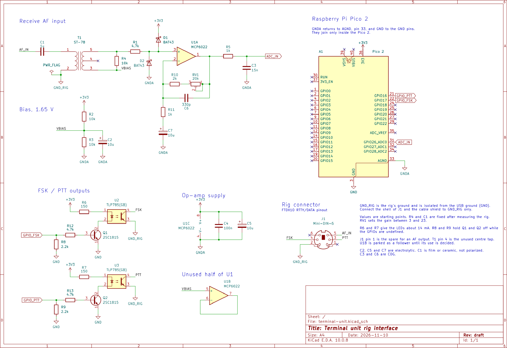

# JL1HIS Terminal Unit

Raspberry Pi Pico 2 を採用した RTTY ターミナルユニット

## 設計方針

なぜ作るかといえば USB Serial では DTR/RTS の bit-bang は精度に限界があるからなので、**キーイングを USB からのデータで直接行わない**のを原則とする。

- PC からは USB Serial と USB Audio の組として見える
- USB Serial はコマンドを送受信するものであり、直接キーイングしたり送信するデータを受け取ることはしない
- RP2350 の使えそうな機能は積極的に使う(特に PIO)
- 接続するリグを問わない回路設計

## アナログ回路

回り込みを防ぐためにリグ側とホスト PC 側はグランド分離する。AF 入力はインピーダンス 10kΩ・数百mV(p-p) を想定している。

## コマンド制御

[docs/control-port.md](./docs/control-port.md) を参照
